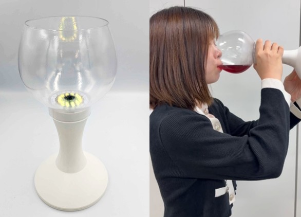
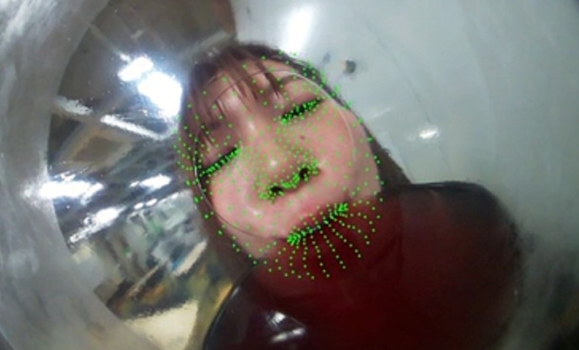
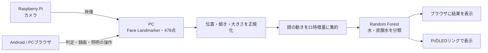

# Delicious Detector Ver2

**飲んだときの顔の動きから、飲料の違いを捉える。**

Raspberry Piのカメラで飲用中の表情を撮影し、PCで顔の動きを解析する研究・デモシステムです。約10秒間の顔ランドマークから特徴量を計算し、**水・炭酸水の2種類を分類**します。判定結果はブラウザとLEDリングで確認できます。技育展向けにソースコードを公開しています。

「おいしさ」を顔の動きから捉えることを目指し、現在は飲料の違いを分類する段階に取り組んでいます。主観的なおいしさを直接推定するモデルは未実装です。

<!-- PHOTO: hero。docs/images/hero.jpg を配置したら、次の画像行だけをコメントの外へ出してください。

-->

[デモの詳細](docs/demo.md) · [学習・評価](docs/research.md) · [写真の追加方法](docs/images/README.md) · [公開前の確認](docs/publishing.md)

## できること

- **飲用中の顔を解析**：MediaPipe Face Landmarkerで478点を取得し、目・口・口角・眉の動きを21個の特徴量にまとめます。
- **10秒ごとに飲料を判定**：Random Forestで水・炭酸水を分類。顔の検出が不十分な場合は判定を保留します。
- **スマートフォンから操作**：同じLANのAndroid／PCブラウザでライブ映像、判定開始、録画、履歴を操作できます。
- **光で結果を表示**：水は青、炭酸水は赤。LEDの色・明るさと赤外線照明も操作できます。
- **実験から評価まで実行**：データ検査、正規化、特徴量生成、被験者単位の交差検証、置換検定を備えています。

## デモの体験

1. カメラに顔が映る位置で、ブラウザの「判定を開始」を押します。
2. 飲料を飲み、約10秒間の顔の動きを収集します。
3. 終了3秒前の案内に合わせて、コップを口から離します。
4. ブラウザとLEDリングで判定結果を確認します。

<!-- PHOTO: demo。docs/images/demo.jpg を配置したら、次の画像行だけをコメントの外へ出してください。

-->

<!-- PHOTO: web-ui。docs/images/web-ui.png を配置したら、次の画像行だけをコメントの外へ出してください。

-->

## 仕組み



正規化は鼻根を原点とし、両目の傾きと眼間距離で補正します。学習とリアルタイム推論で同じ処理を使います。標準の判定条件は、10秒間で顔の検出に成功したフレームが180以上、かつ検出成功率70%以上です。

| 担当 | 使用技術 |
|---|---|
| 撮影・照明 | Raspberry Pi、Picamera2、GPIO、NeoPixel |
| 顔ランドマーク | Python、OpenCV、MediaPipe |
| 特徴量・機械学習 | NumPy、pandas、scikit-learn、joblib |
| 操作画面 | FastAPI、Uvicorn、HTML / CSS / JavaScript |
| 録画・評価図 | FFmpeg、Matplotlib |

## セットアップ

### 必要なもの

- PC：Python 3.11系（開発環境は3.11.9）、Raspberry Piと通信できるLAN
- Raspberry Pi：Picamera2対応カメラ、12灯NeoPixelリング、赤外線照明と駆動回路
- 操作端末：PCブラウザ、または同じLANのAndroidブラウザ
- Face Landmarkerモデルと、自分の実験データで学習した分類モデル

**実験データ・学習済み分類モデルは公開していません。cloneと依存パッケージのインストールだけでは飲料判定は起動できません。** 自分でデータを用意し、下記の学習手順を実行してください。自動テストには実験データやPi実機は不要です。

以下のコマンドは、特記のない限りリポジトリのルートで実行します。

### 1. PCの準備（Windows PowerShell）

```powershell
git clone https://github.com/runa64690/delicious_detect_ver2.git
cd delicious_detect_ver2
python -m venv .venv
.\.venv\Scripts\python.exe -m pip install -r requirements.txt
```

依存パッケージのバージョンは[requirements.txt](requirements.txt)で固定しています。

### 2. Face Landmarkerモデルの配置

[MediaPipe公式のFace Landmarkerガイド](https://ai.google.dev/edge/mediapipe/solutions/vision/face_landmarker)の「Models」からFaceLandmarkerモデルを取得し、ルートに`face_landmarker.task`として配置します。既にファイルがある場合はそのまま利用できます。外部モデルはこのリポジトリには同梱しません。

### 3. データの準備と分類モデルの学習

実験データの列・形式は[データ準備・学習・評価](docs/research.md)を参照してください。`data/labels.csv`と`data/raw_facemesh/`内のCSVを用意します。

初回のみ、除外設定のひな形をコピーします。既存の実験設定は上書きしません。

```powershell
if (-not (Test-Path config/excluded_trials.csv)) {
    Copy-Item config/excluded_trials.example.csv config/excluded_trials.csv
}
```

除外が必要な試行を設定し、順に実行します。

```powershell
.\.venv\Scripts\python.exe scripts/validate_dataset.py --frames 180
.\.venv\Scripts\python.exe scripts/normalize_facemesh.py
.\.venv\Scripts\python.exe scripts/extract_handcrafted_features.py
.\.venv\Scripts\python.exe scripts/train_loso_classifier.py --run-name initial_loso_v1
.\.venv\Scripts\python.exe scripts/train_final_random_forest.py --model-id random_forest_v1
```

推論には`results/models/random_forest_v1/model.joblib`と同じフォルダの`metadata.json`を使います。既存モデルがある開発環境では再学習は不要です。

### 4. Raspberry Piの準備

`raspberrypi/pi_send_camera.py`と`raspberrypi/led_control.py`を、Pi側でも同じディレクトリに配置します。Pi側の実行環境には`picamera2`、`opencv-python`（`cv2`）、`RPi.GPIO`、`board`、`neopixel`が必要です。GPIOやカメラ用パッケージはPiのOS・機種に合わせて準備してください。

配線はLEDデータがGPIO18、赤外線照明の制御がGPIO23です。LEDには適切な5V電源を使用し、PiとGNDを共通にします。LEDリング全体をGPIOピンから給電しないでください。[照明・操作の詳細](docs/demo.md)も参照してください。

## 起動方法

PCで`ipconfig`を実行し、LANのIPv4アドレスを確認します。以下の`192.168.1.20`は例なので、実際のPCのアドレスへ置き換えてください。

**PC側**：

```powershell
.\.venv\Scripts\python.exe web_app.py
```

**Raspberry Pi側**：

```bash
sudo python raspberrypi/pi_send_camera.py --pc-host 192.168.1.20
```

**ブラウザ**：Androidから`http://192.168.1.20:8000`、PC自身から`http://127.0.0.1:8000`を開きます。終了はそれぞれのターミナルで`Ctrl+C`です。

| 通信 | TCPポート |
|---|---:|
| ブラウザ → PC（画面・操作） | 8000 |
| Pi → PC（映像） | 9999 |
| PC → Pi（LED・赤外線照明） | 10000 |

認証のない実験用システムで、映像受信にはPython pickleを使用しています。信頼できる端末だけが接続するLAN内で使用し、インターネットへポートを公開しないでください。

PCウィンドウで操作する場合はWeb版の代わりに`python realtime_classify.py --show-facemesh`を使います。Web版とPCウィンドウ版は同時起動できません。録画・履歴・接続できない場合の確認は[デモの詳細](docs/demo.md)にまとめています。

## 評価と現在の課題

ローカル実験では6名・60試行を収集し、品質条件による1試行の除外後、59試行で評価しました。1名分をテスト、残りを学習に使うLOSO（Leave-One-Subject-Out）を6回行い、未知の被験者に対する分類性能を確認しています。

| モデル | Balanced Accuracy（6 fold平均） |
|---|---:|
| Random Forest | 0.5583 |
| ExtraTrees | 0.5250 |
| Dummy（比較基準） | 0.5000 |

値は既存の`initial_loso_v1`実験結果です。少人数の初期評価であり、一般的な判定精度を確立した段階ではありません。ブラウザに表示するモデルのスコアも、校正済みの正答確率ではありません。

今後はデータの拡充、被験者間の差や撮影条件への対応、時系列モデル（1D-CNN）との比較、おいしさに関する主観評価との関係を検証します。[置換検定の手順と前提](docs/permutation_test_loso.md)も公開しています。

## ソースコードの構成

```text
├─ web_app.py                 # ブラウザ操作用APIサーバー
├─ web/                       # 操作画面
├─ realtime_classify.py       # PCウィンドウでの判定
├─ raspberrypi/               # カメラ送信・LED / IR制御
├─ scripts/                   # 収集・正規化・特徴量・学習・推論・録画
├─ config/                    # 評価条件・除外設定のひな形
├─ tests/                     # 分類・推論・Web操作などの自動テスト
├─ docs/                      # デモ、研究、公開手順、写真
├─ pc_receive_camera.py       # 映像受信・FaceMesh表示
└─ video_record.py            # 収集用の動画・顔座標CSV記録（TCP 50000）
```

`data/`、`facemesh_csv/`、`video_data/`、`results/`はローカルで生成・配置するディレクトリです。動画・顔座標・アンケート、実験用除外設定、モデル、環境設定・認証情報はGit管理から除外します。公開用に選んだ写真だけを`docs/images/`へ追加してください。

## 開発・テスト

```powershell
.\.venv\Scripts\python.exe -m pip install -r requirements-dev.txt
.\.venv\Scripts\python.exe -m unittest discover -s tests -v
```

実機での映像・LED・IR・通信の確認項目は[デモの詳細](docs/demo.md)に記載しています。

## 写真を追加する

`docs/images/`に次の3枚を置き、このREADMEの対応する`PHOTO`コメントから画像行を外すと表示されます。写真が未配置の間はリンク切れの画像を表示しません。

| ファイル名 | 用意する写真 |
|---|---|
| `hero.jpg` | 装置全体。カメラ・LEDリング・操作端末が一緒に見える横長写真 |
| `demo.jpg` | 飲用中の様子。人と装置の位置関係が分かる写真 |
| `web-ui.png` | ライブ映像・判定結果が分かるブラウザ画面のスクリーンショット |

撮り方・サイズ・任意の追加写真は[写真の追加ガイド](docs/images/README.md)を参照してください。

## ライセンス

ソースコードは[MIT License](LICENSE)で公開しています。外部ライブラリ・モデルの利用条件は各配布元を参照してください。
